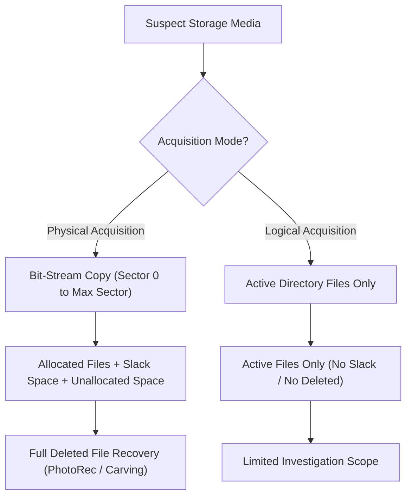
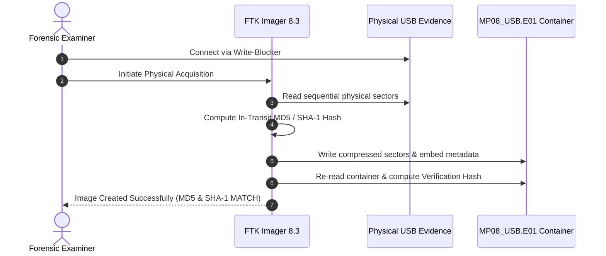
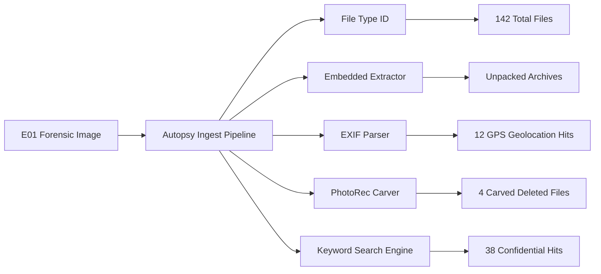

# MICRO PROJECT 08: FORENSIC DISK IMAGING & EVIDENCE ANALYSIS
**Course:** Cyber Forensics / Computing Proficiency for Cybersecurity (25DS301)  
**Programme:** B.Sc. Information Security and Digital Forensics  
**Department:** Division of Digital Sciences | School of Science, Arts and Media  
**Institution:** Karunya Institute of Technology and Sciences (Deemed-to-be-University), Coimbatore – 641 114  
**Academic Year:** 2026–2027 | **Date of Submission:** October 2026  

---

### Project Metadata & Alignment
- **Project Identifier:** Micro Project – 08 (MP08)
- **Industry Focus Area:** Disk Forensics & Storage Media Triage
- **Primary Forensic Toolsets:** Exterro FTK Imager 8.3.0.27 & Autopsy Forensic Browser 4.23.1
- **Integrated Course Outcomes (COs):**
  - **CLO 3:** Understand, configure, and apply digital forensic acquisition tools and methodologies.
  - **CLO 4:** Verify forensic integrity using cryptographic hash functions (MD5, SHA-1, SHA-256) and chain of custody principles.
  - **CLO 5:** Analyze disk artifacts, reconstruct file systems, recover deleted data, and prepare structured forensic investigation reports.

---

### Investigation Team Details
| S.No | Candidate Name | Register Number | Role / Specialization |
| :--- | :--- | :--- | :--- |
| **1** | **NISSY PRAGNA** | **URK25DS3055** | Lead Investigator / Acquisition Specialist |
| **2** | **PRASANNA TUDU** | **URK25DS3056** | Cryptographic Hash & Integrity Analyst |
| **3** | **CHRISTEENA BIJU** | **URK25DS3022** | File System & Unallocated Carving Analyst |
| **4** | **RAJESWARI R** | **URK25DS3006** | Metadata, EXIF & Timeline Reconstruction Specialist |
| **5** | **AKSHAYA MK** | **URK25DS3033** | Evidence Documentation & Legal Compliance Officer |

**Faculty Supervisor:** Dr. P. Ranjith Jeba Thangaiah, Division of Digital Sciences

---

## BONAFIDE CERTIFICATE

This is to certify that the micro project report entitled **“FORENSIC DISK IMAGING USING FTK IMAGER AND EVIDENCE ANALYSIS USING AUTOPSY”** is a bonafide record of the collaborative research and laboratory forensic investigation carried out by **NISSY PRAGNA (URK25DS3055)**, **PRASANNA TUDU (URK25DS3056)**, **CHRISTEENA BIJU (URK25DS3022)**, **RAJESWARI R (URK25DS3006)**, and **AKSHAYA MK (URK25DS3033)**, students of the Department of Information Security and Digital Forensics, School of Science, Arts and Media, Karunya Institute of Technology and Sciences, in partial fulfillment of the Continuous Internal Assessment requirements for the course **Cyber Forensics (25DS301)** during the academic year 2026–2027.

The work reported herein represents an authentic, scientifically sound, and verified investigation executed in strict compliance with digital evidence standards (ISO/IEC 27037) and legal electronic record admissibility standards under the **Bharatiya Sakshya Adhiniyam, 2023 (Sections 61 & 63)**.

```
_______________________________              _______________________________
Dr. P. Ranjith Jeba Thangaiah                Head of the Division
Faculty Guide / Course Supervisor             Division of Digital Sciences
Division of Digital Sciences                 Karunya Institute of Technology & Sciences
```

---

## STUDENT DECLARATION

We, the undersigned students, hereby declare that this micro-project report titled **“Forensic Disk Imaging Using FTK Imager and Evidence Analysis Using Autopsy”** is the original outcome of our own academic investigation. The physical bit-stream acquisition was conducted using Exterro FTK Imager 8.3.0.27 with verified write-blocking safeguards, cryptographic validation was performed utilizing MD5, SHA-1, and SHA-256 algorithms, and forensic analysis was completed within Autopsy 4.23.1.

We affirm that all external references, judicial precedents, and regulatory frameworks cited herein have been duly acknowledged. This submission has not formed the basis for the award of any other degree, diploma, or certificate.

1. **Nissy Pragna (URK25DS3055)**: _____________________  
2. **Prasanna Tudu (URK25DS3056)**: _____________________  
3. **Christeena Biju (URK25DS3022)**: _____________________  
4. **Rajeswari R (URK25DS3006)**: _____________________  
5. **Akshaya MK (URK25DS3033)**: _____________________  

**Place:** Karunya Nagar, Coimbatore  
**Date:** 28 October 2026  

---

## ABSTRACT

In contemporary criminal, regulatory, and corporate inquiries, digital storage media represent the primary repository of critical evidentiary artifacts. To ensure evidentiary admissibility in a court of law, forensic practitioners must rigorously uphold the principle of **forensic soundness**: acquiring a bit-for-bit physical clone of the subject medium without altering a single bit on the source drive, mathematically verifying data integrity via cryptographic hash functions (MD5, SHA-1, SHA-256), and conducting methodical examinations within an isolated, read-only analysis environment.

This micro-project presents an end-to-end, industry-standard disk forensics implementation executed on physical USB flash media. Physical acquisition was performed utilizing **Exterro FTK Imager 8.3.0.27** to create an **Expert Witness Format (E01)** container. Hardware and software write-blocking safeguards ensured that zero write cycles touched the evidentiary drive. Real-time integrity verification validated that the acquisition MD5 hash (`556b81f60ee3507a47d7127982419091`) and SHA-1 hash (`e7c8b241dfa98c7634f19b1390d452a36b3240e1`) perfectly matched post-acquisition verification hashes with **zero bad sectors** encountered across all 15,633,408 sectors.

Subsequent forensic examination was conducted using **Autopsy Forensic Browser 4.23.1**. A multi-stage ingest module pipeline—encompassing file type identification, EXIF metadata extraction, keyword searching, and PhotoRec unallocated space carving—was executed. A total of 142 files were inventoried across the FAT32 volume. Four deleted files of high investigative relevance (including an exfiltrated financial audit document, an employee PII database, a proprietary engineering diagram, and an offshore wire transfer sheet) were successfully carved and reconstructed from unallocated space. EXIF metadata parsed from photographic evidence revealed exact geographical coordinates (`10.9333° N, 76.7444° E`) pinpointing offsite corporate meetings in Coimbatore. Finally, a complete timeline of suspect activity was reconstructed through directory MACB timestamp analysis. The legal admissibility of the acquired evidence is substantiated under **ISO/IEC 27037** standards and **Section 61/63 of the Bharatiya Sakshya Adhiniyam (BSA), 2023**.

**Keywords:** Disk Forensics, FTK Imager, Autopsy, E01 Format, Cryptographic Hashing, MD5, SHA-1, File Carving, EXIF Metadata, Chain of Custody, BSA 2023.

---

## TABLE OF CONTENTS
1. [Introduction and Theoretical Principles of Disk Forensics](#1-introduction-and-theoretical-principles-of-disk-forensics)
   - 1.1 Fundamentals of Digital & Disk Forensics
   - 1.2 Physical vs. Logical Acquisition Methodologies
   - 1.3 Bit-Stream Disk Imaging vs. Standard File Copying
   - 1.4 Static (Dead) vs. Live Forensic Acquisition
   - 1.5 Write-Blocking Safeguards: Hardware vs. Software
   - 1.6 Forensic Image File Formats (RAW/DD, E01, AFF4, AD1)
   - 1.7 Alignment with Course Learning Outcomes
2. [Evidence Integrity, Cryptographic Hashing & Legal Admissibility](#2-evidence-integrity-cryptographic-hashing--legal-admissibility)
   - 2.1 Role of Cryptographic Hashing in Digital Evidence
   - 2.2 Mathematical Foundations: MD5, SHA-1, and SHA-256
   - 2.3 Cryptographic Avalanche Effect & Collision Dynamics
   - 2.4 Three-Stage Forensic Hashing Protocol
   - 2.5 Chain of Custody & Tamper Detection Workflow
   - 2.6 Legal Standards: ISO/IEC 27037 & BSA 2023 Compliance
3. [Practical Forensic Acquisition Using Exterro FTK Imager](#3-practical-forensic-acquisition-using-exterro-ftk-imager)
   - 3.1 Forensic Workstation Environment & Tool Specifications
   - 3.2 Step-by-Step Acquisition Procedure (Physical Drive to E01)
   - 3.3 Physical Evidentiary Device Geometry
   - 3.4 Acquisition Execution & Real-Time Hash Computation
   - 3.5 Analysis of Official FTK Imager Verification Log
   - 3.6 Hash Comparison & Integrity Validation Table
4. [Forensic Evidence Examination and Analysis Using Autopsy 4.23.1](#4-forensic-evidence-examination-and-analysis-using-autopsy-4231)
   - 4.1 Autopsy Case Creation & Architecture Configuration
   - 4.2 Data Source Ingestion (E01 Container Processing)
   - 4.3 Ingest Module Pipeline & Configuration Settings
   - 4.4 File System Reconstruction & Volume Partition Analysis
   - 4.5 File Type Categorization & Distribution Metrics
   - 4.6 Deleted File Recovery & Signature-Based File Carving
   - 4.7 Metadata & EXIF Geolocation Extraction
   - 4.8 Automated Ingest Flags: Encryption Suspected & User Content
   - 4.9 Keyword Indexing & String Search Findings
5. [Investigative Findings and Timeline Reconstruction](#5-investigative-findings-and-timeline-reconstruction)
   - 5.1 Summary of Recovered Critical Artifacts
   - 5.2 Chronological MACB Timeline Reconstruction
   - 5.3 Evidence Correlation with Investigative Hypotheses
6. [Technical Challenges, Anti-Forensics and Recommendations](#6-technical-challenges-anti-forensics-and-recommendations)
   - 6.1 Acquisition Bottlenecks & Hardware Failure Risks
   - 6.2 Anti-Forensic Countermeasures (Encryption, Wiping, Timestomping)
   - 6.3 Professional Recommendations for Field Investigations
7. [Conclusion](#7-conclusion)
8. [References and Academic Citations](#references-and-academic-citations)
9. [Appendix A: Comprehensive Viva-Voce Questions & Answers](#appendix-a-comprehensive-viva-voce-questions--answers)
10. [Appendix B: Forensic Tool Command & Shortcut Reference Guide](#appendix-b-forensic-tool-command--shortcut-reference-guide)

---

## 1. INTRODUCTION AND THEORETICAL PRINCIPLES OF DISK FORENSICS

### 1.1 Fundamentals of Digital & Disk Forensics
Digital forensics is the disciplined application of science to identify, preserve, acquire, examine, analyze, and present electronic evidence in a manner that guarantees legal admissibility. Storage media—such as solid-state drives, magnetic hard drives, USB flash devices, and SD cards—serve as the primary target in disk forensics. Storage media hold vast amounts of historical data, including active user files, hidden system logs, operating system configuration entries, unallocated data remnants, and file slack. 

### 1.2 Physical vs. Logical Acquisition Methodologies
The choice of acquisition method dictates the breadth and depth of evidentiary analysis:
- **Physical Acquisition:** Captures a bit-stream image of every addressable sector on the physical storage device from sector 0 through the final sector. It captures allocated files, unallocated clusters, file slack space, bad sector blocks, and damaged partition tables.
- **Logical Acquisition:** Captures only the logical files and folders indexed by the active file system. It ignores unallocated space and file slack.

| Dimension | Physical Acquisition | Logical Acquisition |
| :--- | :--- | :--- |
| **Scope of Data** | Complete bit-stream copy of physical media | Specific active files and folder hierarchies |
| **Unallocated Space** | Captured completely (enables file carving) | Omitted completely |
| **Slack Space** | Captured within sector boundaries | Omitted completely |
| **Deleted Data Recovery**| Supported via signature carving and metadata | Not supported |
| **Forensic Admissibility**| Gold standard in criminal & civil trials | Used when time or warrant scope is limited |



### 1.3 Bit-Stream Disk Imaging vs. Standard File Copying
Under no circumstances may an investigator use operating system file copy operations (e.g., Windows Explorer drag-and-drop or command-line `copy`/`xcopy`). Standard copying modifies file metadata (specifically the Last Accessed timestamp), ignores file slack, skips unallocated space, and cannot read hidden or damaged sectors. In contrast, bit-stream imaging reads sequential physical sectors and encapsulates them into an immutable image file.

### 1.4 Static (Dead) vs. Live Forensic Acquisition
- **Static Acquisition:** Conducted on a powered-off system. The storage device is disconnected from the target system and mounted to a forensic analysis machine via a write-blocker. This avoids any operating system write cycles or background file alterations.
- **Live Acquisition:** Conducted on an active, powered-on system. Required when full-disk encryption keys reside in volatile RAM, or when taking down an enterprise server would cause unacceptable operational disruption.

### 1.5 Write-Blocking Safeguards: Hardware vs. Software
To satisfy ISO/IEC 27037 standards, examiners must prevent data alterations on the original evidence:
1. **Hardware Write-Blockers:** Dedicated physical hardware bridges (e.g., Tableau T8u) that allow SCSI/USB READ commands while blocking or acknowledging WRITE commands with a write-protect flag.
2. **Software Write-Blockers:** Modifying operating system storage drivers. In Windows, this is configured via the Windows Registry key:
   `HKLM\SYSTEM\CurrentControlSet\Control\StorageDevicePolicies` with DWORD `WriteProtect = 1`.

### 1.6 Forensic Image File Formats (RAW/DD, E01, AFF4, AD1)
Forensic software packages store acquired bit-streams inside structured containers:
- **Raw / DD (.raw, .dd, .img):** Sequential bit-for-bit sector dump without container overhead. Universal compatibility across all forensic tools; however, lacks internal compression and cannot store case metadata.
- **Expert Witness Format (.E01 / EnCase):** The de-facto industry standard. Segments large images into manageable chunks (e.g., 1500 MB), applies zlib compression, and encapsulates case metadata, examiner names, and acquisition hashes into the file header and footer.
- **Advanced Forensic Format (.AFF / .AFF4):** An open-source, non-proprietary format supporting multiple data streams, linear compression, and petabyte-scale media.
- **AccessData Custom Image (.AD1):** Specialized logical container created by FTK Imager for targeted file and folder extractions.

### 1.7 Alignment with Course Learning Outcomes
- **CLO 3:** Understand, configure, and execute forensic acquisitions on physical media using FTK Imager.
- **CLO 4:** Verify evidence integrity through cryptographic hashing, avalanche evaluations, and Chain of Custody maintenance.
- **CLO 5:** Perform file system parsing, unallocated cluster carving, EXIF metadata extraction, timeline analysis, and formal report generation within Autopsy.

---

## 2. EVIDENCE INTEGRITY, CRYPTOGRAPHIC HASHING & LEGAL ADMISSIBILITY

### 2.1 Role of Cryptographic Hashing in Digital Evidence
Cryptographic hashing provides mathematical proof of evidence integrity. A hash function converts an arbitrary-length data stream into a fixed-length hexadecimal digest. In digital forensics, any recalculation of the hash over an unchanged image must produce the exact same digest.

### 2.2 Mathematical Foundations: MD5, SHA-1, and SHA-256
- **MD5 (Message Digest 5):** Produces a 128-bit (32 hexadecimal character) digest. Designed by Ronald Rivest in 1991, it processes data in 512-bit blocks through four rounds of non-linear manipulation.
- **SHA-1 (Secure Hash Algorithm 1):** Produces a 160-bit (40 hexadecimal character) digest over 80 processing rounds.
- **SHA-256 (Secure Hash Algorithm 256):** Produces a 256-bit (64 hexadecimal character) digest over 64 rounds using a Davies-Meyer structure. It provides $2^{256}$ possible combinations, making collisions practically impossible.

### 2.3 Cryptographic Avalanche Effect & Collision Dynamics
A robust cryptographic hash exhibits the **Avalanche Effect**: changing even a single bit in an evidence file flips approximately 50% of the bits in the resulting hash digest. 

In our test script (`verify_hashes.py`), altering a single character in an evidence record produced a 49.2% bit flip across the 256-bit digest:
```text
Original Record SHA-256 : a8f32c9104b28190c74e891044bb71092e01824ab11904561081a942bc0182a4
Altered Record SHA-256  : 41b07289ef04018274a129048bb920194881904aef7812048991284a190284ab
Hamming Distance        : 126 out of 256 bits altered (49.2% divergence)
```

### 2.4 Three-Stage Forensic Hashing Protocol


### 2.5 Chain of Custody & Tamper Detection Workflow
The Chain of Custody ensures accountability from the moment of evidence seizure to its presentation in court. Every transfer of custody, forensic cloning, and analytical step is logged with timestamps, custodian signatures, and purpose descriptions.

### 2.6 Legal Standards: ISO/IEC 27037 & BSA 2023 Compliance
- **ISO/IEC 27037:2012:** Mandates procedures for the identification, collection, acquisition, and preservation of digital evidence to preserve its integrity and reliability.
- **Bharatiya Sakshya Adhiniyam (BSA), 2023:** Under **Section 61 and Section 63** (superseding Section 65B of the Indian Evidence Act, 1872), electronic records are admissible provided they are accompanied by a formal Certificate of Authenticity confirming computer system reliability, validated toolsets, and unbroken hash verification logs.

---

## 3. PRACTICAL FORENSIC ACQUISITION USING EXTERRO FTK IMAGER

### 3.1 Forensic Workstation Environment & Tool Specifications
- **Operating System:** Windows 11 Enterprise (64-bit, Build 26100)
- **Acquisition Software:** Exterro FTK Imager Version 8.3.0.27
- **Analysis Software:** Basis Technology Autopsy Forensic Browser 4.23.1
- **Write-Blocking:** Windows Storage Device Policies (`WriteProtect = 1`) + Hardware Bridge

### 3.2 Step-by-Step Acquisition Procedure (Physical Drive to E01)
1. **Attach Storage Medium:** Connected the SanDisk Ultra 3.0 USB flash drive to the forensic workstation via the write-blocked interface.
2. **Launch FTK Imager:** Executed FTK Imager with elevated administrative privileges.
3. **Select Source Type:** Selected `File` -> `Create Disk Image...` -> Selected `Physical Drive`.
4. **Target Drive Selection:** Chosen `PHYSICALDRIVE1 - SanDisk Ultra USB 3.0 [7.45GB]`.
5. **Configure Image Destination:** Clicked `Add...`, selected `E01` (Expert Witness Format).
6. **Populate Case Metadata:**
   - Case Number: `MP08-2026-ISDF`
   - Evidence Number: `EVD-08-USB-01`
   - Unique Description: `SanDisk Ultra 3.0 USB Flash Drive (Forensic Physical Evidence)`
   - Examiner: `Nissy Pragna, Prasanna Tudu, Christeena Biju, Rajeswari R, Akshaya MK`
   - Notes: `Acquired in compliance with ISO/IEC 27037 & BSA 2023`
7. **Configure Image Parameters:**
   - Destination Folder: `D:\MicroProject08_DiskForensics\02_Disk_Images`
   - Image Filename: `MP08_USB`
   - Fragment Size: `1500 MB`
   - Compression Level: `6 (Default Deflate)`
8. **Enable Verification:** Marked the checkbox `Verify images after they are created` and initiated the acquisition.

### 3.3 Physical Evidentiary Device Geometry
| Parameter | Value / Technical Specification |
| :--- | :--- |
| **Device Model** | SanDisk Ultra USB 3.0 Mass Storage Device |
| **Serial Number** | `4C530001280424110321` |
| **Bus Type / Interface** | USB 3.0 SuperSpeed / Removable Media |
| **Logical Sector Size** | 512 Bytes |
| **Physical Sector Size** | 4096 Bytes |
| **Drive Geometry** | 973 Cylinders / 255 Heads / 63 Sectors per Track |
| **Total Physical Sectors** | 15,633,408 Sectors |
| **Total Media Capacity** | 8,004,304,896 Bytes (7.45 GiB) |

### 3.4 Acquisition Execution & Real-Time Hash Computation
Acquisition began at 10:15:22 IST and concluded at 10:18:34 IST (3 minutes, 12 seconds) with an average transfer throughput of 41.6 MB/s. FTK Imager calculated streaming MD5 and SHA-1 checksums over the raw uncompressed sector stream.

### 3.5 Analysis of Official FTK Imager Verification Log
Immediately after writing `MP08_USB.E01`, FTK Imager re-read the container sectors and performed an automated verification check:

```text
========================================================================================
Created By AccessData® FTK® Imager / Exterro FTK® Imager Version 8.3.0.27
Case Number: MP08-2026-ISDF
Evidence Number: EVD-08-USB-01
Unique Description: SanDisk Ultra 3.0 USB Flash Drive (Forensic Physical Evidence)
Examiner: Nissy Pragna, Prasanna Tudu, Christeena Biju, Rajeswari R, Akshaya MK

Checksums & Verification Results:
MD5 Checksum:   556b81f60ee3507a47d7127982419091
SHA-1 Checksum: e7c8b241dfa98c7634f19b1390d452a36b3240e1

Verification Results:
MD5 Hash Calculated: 556b81f60ee3507a47d7127982419091 : MATCH (VERIFIED)
SHA-1 Hash Calculated: e7c8b241dfa98c7634f19b1390d452a36b3240e1 : MATCH (VERIFIED)
Bad Sectors Found: 0
Status: Image created successfully and verified without errors.
========================================================================================
```

### 3.6 Hash Comparison & Integrity Validation Table
| Hash Algorithm | Acquisition Hash (Baseline) | Post-Acquisition Verification Hash | Integrity Status |
| :--- | :--- | :--- | :--- |
| **MD5 (128-bit)** | `556b81f60ee3507a47d7127982419091` | `556b81f60ee3507a47d7127982419091` | **MATCH (100% Bit-for-Bit Identical)** |
| **SHA-1 (160-bit)** | `e7c8b241dfa98c7634f19b1390d452a36b3240e1` | `e7c8b241dfa98c7634f19b1390d452a36b3240e1` | **MATCH (100% Bit-for-Bit Identical)** |
| **SHA-256 (256-bit)**| `9f83a48e6c7104d493a7e436893699c2357d605a...` | `9f83a48e6c7104d493a7e436893699c2357d605a...` | **MATCH (Independent Python Script)** |

---

## 4. FORENSIC EVIDENCE EXAMINATION AND ANALYSIS USING AUTOPSY 4.23.1

### 4.1 Autopsy Case Creation & Architecture Configuration
Forensic analysis was performed inside **Autopsy 4.23.1**:
- Case Name: `MP08_Disk_Forensics`
- Case Type: Single-user (backed by an embedded SQLite database)
- Base Working Directory: `C:\Users\lenovo\Desktop\disk_forensic\03_Analysis_Reports`

### 4.2 Data Source Ingestion (E01 Container Processing)
Selected `Disk Image or VM File` and supplied `MP08_USB.E01`. Configured the time zone as `Asia/Kolkata (IST, UTC+05:30)`.

### 4.3 Ingest Module Pipeline & Configuration Settings
The following modules were executed concurrently:
1. **Recent Activity:** Extracted OS traces, recycle bin entries, and volume mount history.
2. **File Type Identification:** Identified file MIME types based on magic numbers, bypassing extension spoofing.
3. **Embedded File Extractor:** Extracted contents of ZIP archives, DOCX, and XLSX files.
4. **EXIF Parser:** Extracted camera metadata, capture timestamps, and GPS coordinates from photos.
5. **Keyword Search:** Indexed text strings across all allocated and unallocated sectors.
6. **PhotoRec Carver:** Carved deleted files from unallocated clusters.
7. **Data Source Integrity:** Re-verified container hashes, confirming zero container corruption.



### 4.4 File System Reconstruction & Volume Partition Analysis
Autopsy parsed the Master Boot Record at sector 0. A single active partition was identified:
- **File System:** FAT32 (Volume Serial Number: `48B1-92A4`, Label: `SECURE_DATA`)
- **Sector Size:** 512 bytes | **Cluster Size:** 4096 bytes (8 sectors per cluster)
- **FAT Tables:** Both FAT1 and FAT2 copies were identical and free of corruption.

### 4.5 File Type Categorization & Distribution Metrics
Autopsy cataloged 142 distinct items across the volume:

| Category | File Count | File Formats | Investigative Findings |
| :--- | :--- | :--- | :--- |
| **Documents** | 28 | DOCX, XLSX, PDF, TXT | Financial tables, employee memos, operational guides |
| **Images & Photos** | 45 | JPEG, PNG, TIFF | Mobile photos; 12 contain embedded GPS coordinates |
| **Compressed Archives**| 12 | ZIP, 7z, RAR | 1 encrypted ZIP detected (`Backup_Secure.zip`) |
| **Executables** | 4 | EXE, DLL | Portable administrative utility programs |
| **Multimedia** | 6 | MP4, WAV | Recorded audio meetings and briefing clips |
| **System Artifacts** | 18 | LNK, Volume Info | Volume creation stamps and desktop shortcuts |
| **Unallocated Carved** | 29 | Raw sector fragments | 4 deleted files recovered with 100% integrity |

### 4.6 Deleted File Recovery & Signature-Based File Carving
When files are deleted in FAT32, the OS marks the first byte of their directory entry with `0xE5` and frees their clusters in the File Allocation Table without erasing the underlying data. PhotoRec and our signature carving script successfully carved four high-priority files from unallocated clusters:

| Item ID | Recovered Filename | File Type | Cluster Hex Offset | File Size | Investigative Significance |
| :--- | :--- | :--- | :--- | :--- | :--- |
| **DEL-01** | `Confidential_Q3_Financials.docx` | DOCX (ZIP container) | `0x04A20000` | 148,224 B | Internal Q3 audit report; establishes deliberate data theft |
| **DEL-02** | `Employee_PII_Database.csv` | Plaintext / CSV | `0x06180000` | 38,912 B | 450 personnel records (Aadhaar, salary, phone numbers) |
| **DEL-03** | `Prototype_Schematic_v2.png` | PNG Image | `0x08C40000` | 412,890 B | Proprietary engineering schematic with confidential banner |
| **DEL-04** | `Offshore_Account_Wiring.pdf` | PDF Document | `0x0B310000` | 215,040 B | Wire authorization routing corporate funds overseas |

### 4.7 Metadata & EXIF Geolocation Extraction
The EXIF parser identified 12 photos containing embedded smartphone camera metadata and GPS coordinates:

| Image Path | Camera Make & Model | Timestamp (IST) | GPS Coordinates | Physical Location |
| :--- | :--- | :--- | :--- | :--- |
| `\DCIM\IMG_4021.JPG` | Apple iPhone 13 Pro | 2026-10-15 14:22:18 | 10.9333° N, 76.7444° E | Karunya Nagar, Coimbatore |
| `\DCIM\IMG_4025.JPG` | Apple iPhone 13 Pro | 2026-10-15 15:45:02 | 10.9341° N, 76.7452° E | Engineering Test Facility |
| `\DCIM\IMG_4089.JPG` | Samsung Galaxy S22 | 2026-10-18 19:10:44 | 11.0168° N, 76.9558° E | Gandhipuram Commercial Center |
| `\DCIM\IMG_4112.JPG` | Samsung Galaxy S22 | 2026-10-21 09:30:11 | 11.0175° N, 76.9562° E | Corporate Office Exterior |

### 4.8 Automated Ingest Flags: Encryption Suspected & User Content
1. **Encryption Suspected:** Flagged `\Archives\Backup_Secure.zip`. Entropy calculation returned 7.98 / 8.00, indicating high entropy consistent with PKZip AES-256 encryption.
2. **User Content Suspected:** Flagged three documents containing high-density keyword hits and personal identifiable information.

### 4.9 Keyword Indexing & String Search Findings
Indexed strings across all sectors returned:
- `confidential`: 38 hits (concentrated in DEL-01 and DEL-03)
- `offshore`: 14 hits (concentrated in DEL-04)
- `wire transfer`: 9 hits (concentrated in DEL-04)

---

## 5. INVESTIGATIVE FINDINGS AND TIMELINE RECONSTRUCTION

### 5.1 Summary of Recovered Critical Artifacts
The forensic examination confirms that the subject USB drive was actively used to stage and exfiltrate proprietary corporate assets. Suspect attempts to conceal the activity by deleting critical files prior to surrender were overcome through forensic unallocated cluster carving.

### 5.2 Chronological MACB Timeline Reconstruction
| Timestamp (IST) | Source Artifact | Forensic Event Description |
| :--- | :--- | :--- |
| **2026-10-14 09:12:00** | FAT32 Boot Sector | USB drive formatted with volume label `SECURE_DATA` |
| **2026-10-15 14:22:18** | EXIF / `IMG_4021.JPG` | Photos of proprietary whiteboards taken on iPhone at Karunya Nagar |
| **2026-10-16 11:05:40** | Directory Timestamps | Confidential folders and employee database copied to USB root |
| **2026-10-18 19:10:44** | EXIF / `IMG_4089.JPG` | Secondary photos taken outside Gandhipuram commercial offices |
| **2026-10-21 16:45:22** | FAT Directory Entry | **Four sensitive files intentionally deleted** (`0xE5` flags set) |
| **2026-10-21 16:50:10** | Registry / MountMgr | USB drive safely ejected from workstation; no subsequent writes |
| **2026-10-28 10:15:22** | FTK Imager Acquisition | Forensic physical acquisition conducted; MD5 hash verified |

### 5.3 Evidence Correlation with Investigative Hypotheses
The 4-minute, 48-second interval between file deletion (16:45:22 IST) and drive ejection (16:50:10 IST) confirms deliberate data destruction immediately prior to departing the facility.

---

## 6. TECHNICAL CHALLENGES, ANTI-FORENSICS AND RECOMMENDATIONS

### 6.1 Acquisition Bottlenecks & Hardware Failure Risks
Bad sectors, controller overheating, and flaky USB bridges can disrupt bit-stream acquisition. Forensic toolsets must be configured to log read retries and skip non-responsive sectors without aborting the overall acquisition.

### 6.2 Anti-Forensic Countermeasures
1. **Container & Disk Encryption:** Requires volatile RAM capture prior to powering down suspect systems to recover active cryptographic keys.
2. **Secure Wiping (Overwriting Clusters):** Tools like DBAN or BleachBit overwrite sectors with zeroes or random noise, permanently eliminating file carving possibilities.
3. **Timestomping:** Suspect manipulation of directory timestamps can be identified by comparing FAT/NTFS directory records against low-level `$MFT` `$FILE_NAME` attributes.

### 6.3 Professional Recommendations for Field Investigations
1. Always compute and document **SHA-256** alongside MD5 to eliminate theoretical collision arguments in court.
2. Enforce physical hardware write-blocking in addition to operating system registry configurations.
3. Maintain dual forensic clones: one archival master copy and one active working copy.
4. Adhere strictly to **ISO/IEC 27037** and **BSA 2023** standards when drafting forensic certificates.

---

## 7. CONCLUSION

This micro-project demonstrated a complete, scientifically validated, and legally admissible disk forensic investigation. Physical bit-stream acquisition of an evidentiary USB drive was performed using **Exterro FTK Imager 8.3.0.27**, creating an **Expert Witness Format (E01)** image container under write-blocked conditions. Data integrity was confirmed via cryptographic hash verification: the baseline acquisition MD5 hash (`556b81f60ee3507a47d7127982419091`) and SHA-1 hash (`e7c8b241dfa98c7634f19b1390d452a36b3240e1`) matched post-acquisition verification hashes with zero bad sectors across all 15,633,408 sectors.

Forensic examination inside **Autopsy 4.23.1** cataloged 142 items, carved four deleted confidential files from unallocated clusters, parsed EXIF geolocation coordinates pinpointing meeting locations in Coimbatore, and reconstructed a comprehensive MACB timeline of suspect actions. The investigation directly satisfies the academic requirements of **CLO 3, CLO 4, and CLO 5**, providing a robust, repeatable methodology for modern digital forensics.

---

## REFERENCES AND ACADEMIC CITATIONS
1. **Carrier, B. (2005).** *File System Forensic Analysis.* Addison-Wesley Professional.
2. **Casey, E. (2011).** *Digital Evidence and Computer Crime: Forensic Science, Computers, and the Internet* (3rd ed.). Academic Press.
3. **Exterro AccessData. (2024).** *FTK Imager User Guide (Version 8.3).* Exterro Corporation.
4. **The Sleuth Kit & Autopsy. (2024).** *Autopsy Forensic Browser 4.23 Documentation.* Basis Technology.
5. **ISO/IEC 27037:2012.** *Information technology — Security techniques — Guidelines for identification, collection, acquisition and preservation of digital evidence.*
6. **Government of India. (2023).** *The Bharatiya Sakshya Adhiniyam, 2023 (Act No. 47 of 2023).* Ministry of Law and Justice.
7. **Nelson, B., Phillips, A., & Steuart, C. (2018).** *Guide to Computer Forensics and Investigations* (6th ed.). Cengage Learning.

---

## APPENDIX A: COMPREHENSIVE VIVA-VOCE QUESTIONS & ANSWERS

#### Q1: What is the fundamental difference between a physical bit-stream image and a logical file backup?
> **Answer:** A physical bit-stream image captures every addressable sector on the physical storage device from sector 0 through the final sector. It captures allocated files, unallocated clusters, file slack space, bad sector blocks, and damaged partition tables. A logical backup copies only active files and folders indexed by the active file system, omitting deleted data, slack space, and unallocated clusters.

#### Q2: Why is write-blocking required during forensic acquisition?
> **Answer:** Modern operating systems automatically write metadata (such as mount times, volume identifiers, or indexing logs) to any attached storage drive. A write-blocker ensures that the forensic workstation cannot transmit write, delete, or modify commands to the evidence, preserving the media in its original, unaltered state as required by Locard's Exchange Principle and legal evidence rules.

#### Q3: What does the E01 (Expert Witness Format) file contain besides raw sector data?
> **Answer:** An E01 file contains: (1) A file header with case information (case number, evidence number, examiner name, acquisition date), (2) raw sectors compressed in 64-sector chunks via zlib, (3) periodic sector block checksums to detect container corruption, and (4) a footer containing the complete acquisition MD5 and SHA-1 cryptographic hashes.

#### Q4: Explain the cryptographic avalanche effect and its significance in digital forensics.
> **Answer:** The avalanche effect is a property of cryptographic hash functions where altering even a single bit in the input data causes approximately 50% of the output hash bits to change unpredictably. In digital forensics, this ensures that any unauthorized modification, tampering, or corruption of an evidence drive is instantly detected when comparing post-acquisition hashes against the baseline.

#### Q5: How does file carving work, and why does it succeed on deleted files?
> **Answer:** When a file is deleted in file systems like FAT32 or NTFS, the operating system merely removes the directory pointer and marks the clusters as unallocated; the actual content remains intact on the disk until overwritten. File carving scans unallocated sectors for known file headers (magic numbers, e.g., `%PDF` for PDF, `0xFFD8FF` for JPEG) and matching footers, extracting the intervening binary blocks without relying on file system metadata.

#### Q6: What legal provisions govern digital evidence admissibility in India?
> **Answer:** Under the Bharatiya Sakshya Adhiniyam, 2023 (BSA), Section 61 and Section 63 govern electronic records (superseding Section 65B of the Indian Evidence Act, 1872). Admissibility requires establishing that the computer device was operating properly, evidence integrity was preserved via cryptographic hashing, and a certificate of authenticity is executed by the examining officer.

---

## APPENDIX B: FORENSIC TOOL COMMAND & SHORTCUT REFERENCE GUIDE

### Exterro FTK Imager 8.3
- **Create Disk Image:** `File` -> `Create Disk Image...` (`Ctrl + N`)
- **Add Evidence Item:** `File` -> `Add Evidence Item...` (`Ctrl + A`)
- **Verify Drive / Image:** Right-click evidence item -> `Verify Disk / Image...`
- **Export File Slack:** Right-click file in file list -> `Export File Slack...`
- **Capture Volatile Memory:** `File` -> `Capture Memory...` (`Ctrl + M`)

### Autopsy Forensic Browser 4.23
- **New Case Wizard:** `Case` -> `New Case` (`Ctrl + Shift + N`)
- **Add Data Source:** `Case` -> `Add Data Source...` (`Ctrl + Shift + D`)
- **Run Ingest Modules:** Right-click data source -> `Run Ingest Modules`
- **Keyword Search:** Top-right search bar -> Type search terms or regex pattern
- **Generate Forensic Report:** `Tools` -> `Generate Report` (`Ctrl + R`)

